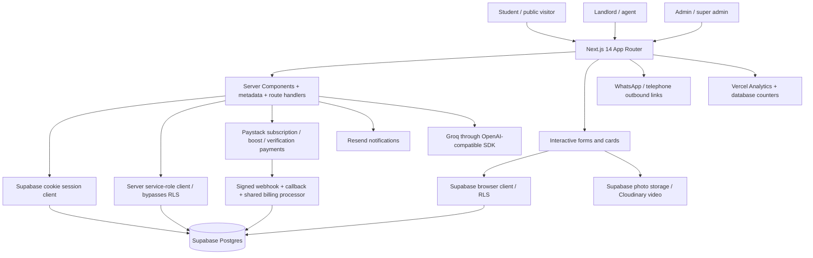

# HousePlug current-state audit

Audit date: 11 November 2026 (Africa/Lagos). Target: HOUSEPLUG_CODEX_MASTER_BRIEF.md v1.0, read completely. Repository: Manjayy-645/houseplug, main snapshot `d7458c002e68fbdf81dbe67c59ead344680ea93d`.

> Product update, 11 November 2026: this audit preserves the original discovery evidence. Requirements for an agent-confirmed inspection engine are superseded by direct student-to-agent WhatsApp contact. No booking, platform assignment or appointment confirmation is required. See [current product contract](houseplug-direct-contact-model.md) and [implementation coverage](houseplug-release-runbook.md).

## Scope and evidence limits

269 text source/configuration/migration files retrieved at the pinned commit. Full tree inventoried: 432 entries, including directories. This is a read-only source snapshot, not an authenticated Git checkout. No application code, production data, infrastructure, GitHub branches or deployments changed. Documentation prepared for PR A0; no remote PR opened.

Live GET checks: homepage, apex redirect, Browse, robots.txt and sitemap.xml all returned final HTTP 200. Apex redirected to www. Chromium checked homepage responsiveness and captured screenshots at 320, 375, 768 and 1280px; document width matched viewport in each check. This does not establish keyboard accessibility, full-flow QA or real-device performance. Public browsing may increment ordinary view analytics. No forms, payment requests, messages, private APIs or adversarial production probes submitted.

No authenticated production database, SQL grants/policy catalog, applied migration history, backups, GSC, private analytics, Paystack dashboard, deployment configuration or source-to-deployment commit attestation inspected. Source findings are not proof of deployed database exploitability. Brief-provided audience/growth numbers are assumptions, not measurements. No build, automated application tests, migration replay, Rich Results Test or real-device performance measurement run.

## Executive recommendation

Keep Next.js, Supabase, existing listing routes, dashboards and working WhatsApp discovery. Start with security validation and narrow containment, listing truth, then preserve direct WhatsApp contact with accurate click tracking and optional consented housing assistance. Do not begin with a broad homepage rebuild or new payment architecture.

Immediate sequence: A0 documentation → S0 staging authorization probe/containment → T0 remove synthetic listings → T1 conservative split suppression → T2 scoped trust/cost wording → Q0 functional search repair. In parallel approve fee/verification policy and inventory sampling, then additive fees/evidence/freshness contracts. Build the measurable enquiry journey before growth features.

## Architecture

Framework Next.js ^14.2.33, React ^18.2, TypeScript, Tailwind 3, Radix/shadcn dependencies, react-hook-form/Zod. npm is documented; package-lock exists in tree. Many dependencies use `latest`, so reproducibility/security review should include the lockfile before any install. No ORM: direct Supabase queries and SQL migrations. Photos are actually uploaded to Supabase in the landlord form; video uses Cloudinary, more precise than README's broad media description.

Roles: student, landlord, agent, admin, super_admin. Middleware gates landlord/admin routes; student layout also checks role. API routes are excluded from middleware and must enforce authorization independently. Supabase service client is used on several public server pages: retain narrow projections and explicit publication filters when changing RLS.

README documents automatic Vercel deployments from main. `vercel.json` schedules weekly stats emails; SQL includes subscription/boost cron jobs. Actual deployment settings, cron health, staging, backups and restore capability need evidence. Existing signed verification-document URL endpoint is a useful foundation. No CI workflow found in the complete tree. One diagnostic script is not an automated test suite.

## Severity-ranked findings

P0 = privacy/security exposure, material trust/price risk, or the core enquiry outcome. P1 = conversion/discoverability and operations; P2 = adjacent product maturity; P3 = scale after pilot evidence. P0 tickets need sequencing, not one large PR.

| ID | Priority | Evidence and consequence | Required action |
|---|---|---|---|
| S0 | P0 | Public profile SELECT policies allow all rows; profiles contain email/phone and verification document pointers/NIN. Owner UPDATE policies constrain rows, not privileged columns. Signup trigger trusts metadata role. | Inspect deployed grants/triggers/RLS safely in staging; restrict private columns and privileged writes; allowlist self-service roles. Do not test escalation on production. |
| T0 | P0 | Detail route fabricates active listings for IDs 1/2/3, with stock photos, prices, views and placeholder phone numbers. | Remove public fallback; use existing notFound path; keep any demo fixtures outside production routes. |
| T1 | P0 | Cards, contact panels, detail price header and split calculator divide rent by two/three with no owner authorization gate, even though occupancy defaults to one. | Suppress split recommendations until explicit permission and sufficient occupancy are recorded; test every surface. |
| T2 | P0 | Profile verified status becomes generic Verified/property-checked messaging; metadata defaults to verified even when evidence is absent. | Conservative wording now; independent listing evidence dimensions later. Do not migrate historic verified profiles into physical inspection claims. |
| F0 | P0 | price_yearly is annual rent; panels label it Total Price. Agent fee null falls back to zero; caution/legal/service/other mandatory fees and total completeness absent. | Unknown remains unknown; itemized fee contract and explicit rent vs move-in totals; owner-sampled backfill. |
| A0 | P0 | Active status filters exist, but no listing confirmation timestamp/freshness expiry. Four statuses mix moderation/availability. Active edits stay active. Owner row policies do not themselves protect approval fields. | Separate moderation from availability, protected server transitions, fee edit re-review and configurable freshness. |
| L0 | P0 | WhatsApp links, clicks and views exist; no durable qualified housing lead / agent-confirmed inspection workflow found. | Consentful persisted requests, lead IDs and state audit; then agent confirmation and attended outcomes. |
| R0 | P0 | Active roommate rows publicly selectable in migration; guest page suppresses phone in UI but this is not database privacy. Any signed-in user receives broader records. | Private contact fields, public minimal projection, consent-based release and later mutual connections. |
| P0 | P0 | Billing marks payment success before entitlement writes. Failure after success causes retries to skip work; concurrent requests can pass the precheck. Initiate accepts listing/service IDs without ownership lookup; processor updates by ID using service role. | Approved payment hardening plan: ownership, expected amount/currency/product checks, durable fulfilment state, atomic idempotency/retry tests. Preserve existing Paystack integration. |
| Q0 | P1 urgent | Hero emits type/price; Browse expects room_type/min_price/max_price. Sidebar emits verified/amenities; Browse never applies those predicates. | Shared validated query contract; truthful rent-budget wording until complete cost filtering exists. |
| E0 | P1 urgent | Live robots/sitemap reference preview deployment hostname; page canonical uses apex, which redirects to www. | Owner chooses canonical host; central URL validation, redirects and sitemap/robots consistency. |
| QA0 | P0 enabling | No test command, assertions suite or CI workflow; migration history has repair scripts and duplicate numeric prefixes. | Baseline focused tests, clean schema replay and isolated role fixtures before product/schema changes. |
| M0 | P1 | Headline trust count hardcoded 500+; live Browse reports 70 active results, not 70 verified/fresh properties. | Remove unsupported count, later use audit-backed eligibility counts. Views>=50 drive High interest, not qualified enquiries. |

Direct references:
- [supabase/migrations/023_profile_avatar_read_access.sql:18](https://github.com/Manjayy-645/houseplug/blob/d7458c002e68fbdf81dbe67c59ead344680ea93d/supabase/migrations/023_profile_avatar_read_access.sql#L18)
- [supabase/migrations/019_fix_rls_recursion_final.sql:26](https://github.com/Manjayy-645/houseplug/blob/d7458c002e68fbdf81dbe67c59ead344680ea93d/supabase/migrations/019_fix_rls_recursion_final.sql#L26)
- [supabase/migrations/029_trigger_skip_oauth.sql:19](https://github.com/Manjayy-645/houseplug/blob/d7458c002e68fbdf81dbe67c59ead344680ea93d/supabase/migrations/029_trigger_skip_oauth.sql#L19)
- [app/auth/callback/route.ts:117](https://github.com/Manjayy-645/houseplug/blob/d7458c002e68fbdf81dbe67c59ead344680ea93d/app/auth/callback/route.ts#L117)
- [app/(main)/listing/[id]/page.tsx:153](https://github.com/Manjayy-645/houseplug/blob/d7458c002e68fbdf81dbe67c59ead344680ea93d/app/(main)/listing/[id]/page.tsx#L153)
- [components/listing-card.tsx:129](https://github.com/Manjayy-645/houseplug/blob/d7458c002e68fbdf81dbe67c59ead344680ea93d/components/listing-card.tsx#L129)
- [components/listing/contact-card.tsx:69](https://github.com/Manjayy-645/houseplug/blob/d7458c002e68fbdf81dbe67c59ead344680ea93d/components/listing/contact-card.tsx#L69)
- [components/listing/contact-card.tsx:144](https://github.com/Manjayy-645/houseplug/blob/d7458c002e68fbdf81dbe67c59ead344680ea93d/components/listing/contact-card.tsx#L144)
- [components/listing/roommate-split-section.tsx:99](https://github.com/Manjayy-645/houseplug/blob/d7458c002e68fbdf81dbe67c59ead344680ea93d/components/listing/roommate-split-section.tsx#L99)
- [components/landlord/listing-form.tsx:48](https://github.com/Manjayy-645/houseplug/blob/d7458c002e68fbdf81dbe67c59ead344680ea93d/components/landlord/listing-form.tsx#L48)
- [app/(main)/listing/[id]/page.tsx:465](https://github.com/Manjayy-645/houseplug/blob/d7458c002e68fbdf81dbe67c59ead344680ea93d/app/(main)/listing/[id]/page.tsx#L465)
- [components/landlord/listing-form.tsx:272](https://github.com/Manjayy-645/houseplug/blob/d7458c002e68fbdf81dbe67c59ead344680ea93d/components/landlord/listing-form.tsx#L272)
- [supabase/migrations/031_listing_unavailable_status.sql:6](https://github.com/Manjayy-645/houseplug/blob/d7458c002e68fbdf81dbe67c59ead344680ea93d/supabase/migrations/031_listing_unavailable_status.sql#L6)
- [components/hero-search.tsx:19](https://github.com/Manjayy-645/houseplug/blob/d7458c002e68fbdf81dbe67c59ead344680ea93d/components/hero-search.tsx#L19)
- [app/(main)/browse/page.tsx:97](https://github.com/Manjayy-645/houseplug/blob/d7458c002e68fbdf81dbe67c59ead344680ea93d/app/(main)/browse/page.tsx#L97)
- [components/filter-sidebar.tsx:59](https://github.com/Manjayy-645/houseplug/blob/d7458c002e68fbdf81dbe67c59ead344680ea93d/components/filter-sidebar.tsx#L59)
- [supabase/migrations/ROOMMATE_MIGRATION.sql:25](https://github.com/Manjayy-645/houseplug/blob/d7458c002e68fbdf81dbe67c59ead344680ea93d/supabase/migrations/ROOMMATE_MIGRATION.sql#L25)
- [app/(main)/roommates/page.tsx:75](https://github.com/Manjayy-645/houseplug/blob/d7458c002e68fbdf81dbe67c59ead344680ea93d/app/(main)/roommates/page.tsx#L75)
- [app/api/payments/initiate/route.ts:15](https://github.com/Manjayy-645/houseplug/blob/d7458c002e68fbdf81dbe67c59ead344680ea93d/app/api/payments/initiate/route.ts#L15)
- [lib/billing.ts:66](https://github.com/Manjayy-645/houseplug/blob/d7458c002e68fbdf81dbe67c59ead344680ea93d/lib/billing.ts#L66)
- [app/page.tsx:173](https://github.com/Manjayy-645/houseplug/blob/d7458c002e68fbdf81dbe67c59ead344680ea93d/app/page.tsx#L173)
- [app/sitemap.ts:8](https://github.com/Manjayy-645/houseplug/blob/d7458c002e68fbdf81dbe67c59ead344680ea93d/app/sitemap.ts#L8)
- [app/robots.ts:4](https://github.com/Manjayy-645/houseplug/blob/d7458c002e68fbdf81dbe67c59ead344680ea93d/app/robots.ts#L4)

## Brief coverage matrix

Status applies to source capability; implemented does not mean tested in production.

| Brief sections | Status | Existing foundation | Gap / dependency |
|---|---|---|---|
| §0 principles / north star | Partially implemented | Student discovery, direct contact, campus IDs | No qualified-lead/inspection metric; operational definition and owner adoption needed |
| §1 audit | Already implemented for source discovery; Needs data verification | This audit, backlog, routes and evidence | Production schema/inventory, backups, analytics and deploy settings unverified |
| §2 public observations | Needs data verification | Claims and splits confirmed in current HTML/source | Property authenticity, actual fee and occupancy permissions need operator sampling |
| §3 phased roadmap | Partially implemented | Existing marketplace and dashboards | Reordered backlog below aligns truth/security before growth |
| §4 exact homepage | Partially implemented | Hero, search, cards, campus links, how-it-works, roommates/services, footer | Exact new copy/layout missing; no housing assistance persistence, eligible counts, visible FAQs or published guides |
| §5 browse/details | Partially implemented | Active filters, pagination, galleries/video, amenity and agent fees, saves/reviews/contact | Broken parameter mapping, ignored filters, missing complete fees, scoped checks, freshness, reporting, sharing consent |
| §6 qualified enquiries / inspections | Missing | WhatsApp/phone outbound, email helpers, audit utilities | Lead model, guarded state transitions, triage, scheduling, outbox, SLA, dedupe and consent |
| §7 agent operations | Partially implemented | Own listings, billing, analytics, reviews, verification, availability toggle; admin moderation/appeals | Authority checks, stale/duplicate queues, protected fee edits, inspection workflow and response SLA |
| §8 roommates | Partially implemented | Create/edit/pause/found; university, gender/budget/lifestyle/lodge matching | Private accepted connections, expiry, blocking/reporting, opt-out, visibility consent and age review |
| §9 services | Partially implemented; Needs data verification | Providers, categories, campus discovery, WhatsApp, paid listings/boosts | Vetting/safety rules, supplier threshold, complaint/request/completion records; live sitemap had zero service detail URLs |
| §10 SEO | Partially implemented | Server-rendered pages, metadata, OG, robots/sitemap, Organization/WebSite/Breadcrumb/FAQ/residence schema | Preview-host leakage, pagination canonical omission, campus/neighbourhood hubs and guides absent, truthful verification/schema cleanup |
| §11 recruitment | Missing in application; Needs owner approval | Official WhatsApp channel links | No persistent UTM/referral-to-lead attribution or ambassador operations; do not automate outreach |
| §12 analytics | Partially implemented | Vercel Analytics, view/WhatsApp/phone counters, activity events, dashboards | Standard outcome events, attribution/lead IDs, deduplication and privacy-safe inspection funnel |
| §13 suggested data | Partially implemented | Reuse profiles/listings/payments/roommates/services/admin models | Add missing concepts incrementally, not duplicate users/agents/listings |
| §14 privacy/safety | Partially implemented; Needs owner approval | Safety/terms/privacy pages, legal/marketing consent columns, account deletion route, bans/appeals, signed document URLs | RLS hardening, retention/export, consent to sharing, incident/reporting, supplier/minor policies; legal review |
| §15 tests / launch gate | Missing | Manual diagnostic only | Unit/integration/mobile/security/SEO suite and CI; staging, mobile/manual and restore sign-off |
| §16 PR phases | Partially implemented | Working stack to preserve | Proposed smaller sequence in implementation plan; dates depend on operator capacity |
| §17 expansion/leadership | Needs data verification / Needs owner approval | Four campus constants | No evidence for #1, national scope, market fit or campus supply gates |
| §18 reporting | Already implemented for this discovery | Evidence, limitations, files, next tickets | Later PRs require actual tests/screenshots/rollback; no success claims made here |
| §19 sources | Needs data verification | External sources listed in brief | No independent legal or competitor/keyword validation performed |
| §20–21 instructions | Planning scope satisfied | No broad changes or deploy | Future changes require separate authorization and reviewed PRs |

## Database comparison and migration risk

50 SQL migration files are tracked, including duplicate `004` prefixes and uppercase one-off setup scripts. Applied order is unknown. Some repair scripts drop policies/functions and assign a named user an admin role; never replay blindly against production. Occupancy/available_from/furnishing/floor fields are referenced in application but their creation was not found in tracked SQL. `saved_listings` and base `service_providers` creation also were not found; service enhancement SQL assumes the latter already exists. This is evidence of incomplete reproducibility, not proof these tables/columns are absent in production.

| Concept | Existing model | Required adaptation |
|---|---|---|
| Users / roles | auth.users + profiles | Keep identity; separate private data from public display; privileged role/verification writes server controlled |
| Housing | listings with landlord_id, campus string, rent integer NGN, address/area, arrays of media/amenities | Structured fees with unknown/refundable/mandatory semantics, consent to sharing, protected moderation, separate availability and confirmations |
| Verification | profiles status/type/docs/reviewer/time | Add evidence by subject/dimension, expiry/revocation; profile identity ≠ every property physically inspected |
| Fees | price_yearly + agent fee type/amount | Add line items, period/currency/unit constraints, completeness and source/reviewer; retain old read compatibility during migration |
| Payments | payments/subscriptions/listing_boosts/platform_settings | Keep Paystack; distinct fulfilment state, immutable expected order data and retry/outbox |
| Roommates | roommate_profiles + target_listing_id | Private contact storage, public projection, connection acceptance, block/report/expiry |
| Services | service_providers referenced; enhancements tracked | Recover base schema first; vetting and controlled service requests later |
| Moderation | audit_logs, bans, appeals, listing_appeals | Extend to reports, fee changes, verification evidence and guarded transitions; audit table immutability not proven |
| Metrics | counters, activity_events, university_requests | University demand suggestions are not housing requests; add privacy-safe leads/events and source dimensions |
| Geography/content | UNIVERSITIES constants; free-text areas | Reuse constants initially; controlled slugs/campus publication metadata and reviewed editorial content later |

New concepts absent from tracked schema/routes: listing_fees, dimensioned verification_evidence, housing_requests, inspection_requests, lead transition events, notification outbox, roommate_connection_requests, reports/blocking, content pages/guides and referral attribution. Confirm actual catalog before adding tables.

## Pricing audit

Housing `price_yearly` is integer naira; Paystack/platform settings are kobo. Preserve explicit units and avoid a 100× conversion bug. `lib/paystack.ts` fallbacks: Pro ₦5,000/month or ₦45,000/year; Business ₦15,000/month or ₦135,000/year; verification ₦2,000; boosts ₦1,500/7d, ₦4,000/30d, urgent ₦500, refresh ₦300; service listing ₦3,000. These are code defaults, not verified deployed prices. Annual subscription default is nine monthly payments, not twelve. DB platform settings may override values.

No full move-in cost model exists. Do not rename annual-rent filtering to total move-in budget without backend support. A fixed fee with missing amount is unknown, not free. Owner must approve mandatory categories, inspection recipient/refund policy, platform fee semantics and price truth samples. Existing paid ranking must not be confused with verified eligibility; label sponsored placements after commercial review.

## Inventory/data audit: what was actually observable

Live Browse reported 70 rooms and rendered 12 unique listing links on page one. Live sitemap contained 70 listing URLs, 8 roommate detail URLs and no service detail URLs (96 total URLs). These are publication counts, not independent inventory verification. All 12 visible Browse cards showed the same agent name and UniPort; this suggests first-page supply concentration, not a whole-database percentage. Repeated rents are not duplicate-property proof. No sensitive person-level inventory export was saved in deliverables.

Unverified: duplicate ownership/physical units, fee discrepancies in descriptions, stale availability, occupied units, shared-occupancy permission, image provenance, agency authority, independently active campus supply and provider vetting. Obtain a read-only authorized inventory sample/export and policy catalog; do not use the public profile policy to harvest private data.

Sampling plan: all promoted listings plus stratified sample by campus/area/agent/price; reconcile rent vs first payment/renewal, mandatory fee unknowns, owner sharing permission/capacity, evidence scope/expiry, last availability confirmation, duplicate media/address and active ownership. Report aggregate completeness/freshness/concentration with denominators. Quarantine disputed listings from promotion, preserve history, and require owner-reviewed corrections.

## Live promoted-listing sample — urgent confirmed discrepancies

Three homepage-linked property URLs were fetched read-only. All returned HTTP 200 and all displayed occupancy **1 student**, yet each rendered two/three-person split suggestions. This is a live UI contradiction, not merely a hypothetical schema gap.

| Public listing | Display vs description | Interpretation |
|---|---|---|
| [51159793-28cb-4219-b7ad-c8fdb57f6625](https://www.houseplug.ng/listing/51159793-28cb-4219-b7ad-c8fdb57f6625) | ₦85,000/year; negotiable agent fee starts at ₦0; occupancy one alongside split calculator | Unknown agency fee presented as zero; sharing eligibility not enforced |
| [44568af6-10f0-41ef-9c1f-30d0ba77e4a6](https://www.houseplug.ng/listing/44568af6-10f0-41ef-9c1f-30d0ba77e4a6) | “Total Price” ₦250,000/year; description says first payment including agency ₦440,000, renewal ₦250,000, inspection ₦6,000 | First-payment disclosure exceeds displayed annual figure by ₦190,000; inspection wording needs operator reconciliation rather than automatic arithmetic |
| [c826e34c-fa46-4270-a46a-d74d622eb0d5](https://www.houseplug.ng/listing/c826e34c-fa46-4270-a46a-d74d622eb0d5) | “Total Price” ₦250,000/year; description says first payment ₦400,000, renewal ₦250,000, agency included, inspection ₦7,000 | ₦150,000 initial-payment difference and separately disclosed inspection fee; structured cost display incomplete |

These are conflicting public representations; the descriptions have not been verified with the owner and are not accepted as authoritative payment quotes. Do not calculate a corrected total or change rent automatically. Reconcile the fee source, recipient and all mandatory charges before featuring.

The same sampled pages showed an “Unverified landlord” warning in contact panels while the landlord card said “ID Verified” and “Replies within a few hours.” Those latter strings are hardcoded in `components/listing/landlord-card.tsx:58` and `:61`; no response-SLA measurement feeds them. T2 must include this file. This contradicts a scoped trust experience even without inspecting private verification documents.

## SEO/live evidence

- Homepage and Browse have meaningful content in raw HTML; discovery is not wholly dependent on JavaScript.
- Apex HTTP request followed redirect to www. Homepage canonical still names apex. Host choice requires one consistent URL helper and redirect plan.
- Live robots Host/Sitemap and all sitemap loc values refer to `houseplug-ei5h.vercel.app`. Correct configured base URL and validate URLs before output. Do not assume production environment value without inspecting settings.
- Source Browse canonical builds university/room_type parameters but omits page; page-two canonical behavior needs correction/testing.
- Schema already uses SingleFamilyResidence, not Product merchant markup. Review suitability for room offerings; generic InStock and verified fallback language are not evidence of availability.
- Real property page eligibility checks exist; unavailable pages currently notFound for public readers. Decide meaningful temporarily unavailable pages vs permanent removal before changing status codes.
- No campus/neighbourhood hub routes or guides route found. Preserve canonical listing IDs and add substantive hubs only after inventory/content gates.
- GSC/index coverage, rankings, real-user CWV and keyword volume unverified. No claim of SEO improvement.

## Tests, QA, security and monitoring baseline

`package.json` has dev/build/start/lint, no test command or test runner. `test-anon.mjs` prints a live query response with no assertions, depends on dotenv not declared directly, and should not become a production-data test. No .github workflow in tree. No rate-limit implementation or feature flag facility found. Public review POST has Zod validation but no authenticated/confirmed-experience gate or rate limiter; migration 036 allows public inserts, so review credibility/spam prevention also needs hardening. Resend/Termii/Groq integration and Vercel Analytics exist; error monitoring/PITR/restore/alert configuration not established.

Executed: pinned-source/tree inspection, source searches, public HTTP GET checks, raw HTML/XML parsing, Chromium homepage responsive smoke checks. No build/test suite execution because this discovery snapshot has no configured secrets/dependencies and no declared test suite; no need to install or fabricate a passing build. Future PRs must use staging credentials and restore-safe SQL fixtures.

Security priority is to check effective privileges, not just UI guards: public profile projections, role/verification writes, owner listing approval/status/featured fields, roommate contact rows, payment listing/service ownership, banned users, admin API boundaries, signed URL lifetime and logging. Billing currently logs full transaction metadata, which may carry identity-document pointers/NIN; redact sensitive metadata.

Environment names referenced in source (values never inspected): `CLOUDINARY_API_KEY`, `CLOUDINARY_API_SECRET`, `CRON_SECRET`, `EMAIL_FROM`, `GROQ_API_KEY`, `NEXT_PUBLIC_APP_URL`, `NEXT_PUBLIC_CLOUDINARY_CLOUD_NAME`, `NEXT_PUBLIC_CLOUDINARY_UPLOAD_PRESET`, `NEXT_PUBLIC_SITE_URL`, `NEXT_PUBLIC_SUPABASE_ANON_KEY`, `NEXT_PUBLIC_SUPABASE_URL`, `NODE_ENV`, `PAYSTACK_SECRET_KEY`, `RESEND_API_KEY`, `SUPABASE_SERVICE_ROLE_KEY`, `TERMII_API_KEY`.

## Additional findings to retain in follow-up

- Profile migration 037 adds `is_banned`, whereas base schema/middleware use `banned`; inspect effective enforcement across roles and server actions.
- Roommate gender compatibility uses substring matching: `female` includes `male`, so Female Only can incorrectly pass a male candidate. Add exact normalized enum comparisons and a full reciprocal-preference test matrix in R1.
- Generic schema/metadata fallbacks claim verified status without scoped evidence; correcting visible badges alone is insufficient.
- Anonymous reviews and public activity-event inserts need abuse/deduplication controls; counter totals are not unique people or qualified demand.

## Owner decisions / evidence needed

1. Choose canonical public hostname (www currently receives traffic); confirm preview/staging isolation and owner for production configuration.
2. Explain actual identity, authority and physical property inspection procedures; approve evidence labels and historic badge treatment.
3. Confirm fee categories, unknown-fee rules, inspection fee recipient, refundable deposits and approved sharing permissions/capacity.
4. Set availability confirmation window, stale inventory policy and staff responsible for rechecks (14 days in brief is a proposed metric, not evidence).
5. Name the ops owner and staffed hours for lead triage/agent confirmation; agree pilot SLA without public guarantee.
6. Provide authorized read-only schema/catalog and de-identified inventory sample; confirm migration history, backups and restore test.
7. Approve contact-sharing consent, retention/deletion/export, roommate visibility/minors and supplier safety policies with qualified review.
8. Confirm current deployed platform prices and whether existing paid service listings must remain available during staged rollout.

## Route inventory (actual files)

Route groups do not add URL segments. Public `/landlord/[username]` is distinct from protected landlord dashboards. API handlers authenticate independently; this inventory does not assert every handler is adequately secured.

| URL | Kind | File |
|---|---|---|
| `/forgot-password` | Page | `app/(auth)/forgot-password/page.tsx` |
| `/login` | Page | `app/(auth)/login/page.tsx` |
| `/reset-password` | Page | `app/(auth)/reset-password/page.tsx` |
| `/signup` | Page | `app/(auth)/signup/page.tsx` |
| `/about` | Page | `app/(main)/about/page.tsx` |
| `/browse` | Page | `app/(main)/browse/page.tsx` |
| `/card/[username]` | Page | `app/(main)/card/[username]/page.tsx` |
| `/contact` | Page | `app/(main)/contact/page.tsx` |
| `/landlord/[username]` | Page | `app/(main)/landlord/[username]/page.tsx` |
| `/listing/[id]` | Page | `app/(main)/listing/[id]/page.tsx` |
| `/privacy` | Page | `app/(main)/privacy/page.tsx` |
| `/profile` | Page | `app/(main)/profile/page.tsx` |
| `/roommates/[id]` | Page | `app/(main)/roommates/[id]/page.tsx` |
| `/roommates/create` | Page | `app/(main)/roommates/create/page.tsx` |
| `/roommates` | Page | `app/(main)/roommates/page.tsx` |
| `/safety` | Page | `app/(main)/safety/page.tsx` |
| `/saved` | Page | `app/(main)/saved/page.tsx` |
| `/services/[id]` | Page | `app/(main)/services/[id]/page.tsx` |
| `/services/manage` | Page | `app/(main)/services/manage/page.tsx` |
| `/services` | Page | `app/(main)/services/page.tsx` |
| `/terms` | Page | `app/(main)/terms/page.tsx` |
| `/admin/admins` | Page | `app/admin/admins/page.tsx` |
| `/admin/analytics` | Page | `app/admin/analytics/page.tsx` |
| `/admin/audit` | Page | `app/admin/audit/page.tsx` |
| `/admin/dashboard` | Page | `app/admin/dashboard/page.tsx` |
| `/admin/export` | Page | `app/admin/export/page.tsx` |
| `/admin/listings/[id]/edit` | Page | `app/admin/listings/[id]/edit/page.tsx` |
| `/admin/listings/create` | Page | `app/admin/listings/create/page.tsx` |
| `/admin/listings` | Page | `app/admin/listings/page.tsx` |
| `/admin` | Page | `app/admin/page.tsx` |
| `/admin/revenue` | Page | `app/admin/revenue/page.tsx` |
| `/admin/reviews` | Page | `app/admin/reviews/page.tsx` |
| `/admin/roommates` | Page | `app/admin/roommates/page.tsx` |
| `/admin/settings` | Page | `app/admin/settings/page.tsx` |
| `/admin/subscriptions` | Page | `app/admin/subscriptions/page.tsx` |
| `/admin/university-requests` | Page | `app/admin/university-requests/page.tsx` |
| `/admin/users` | Page | `app/admin/users/page.tsx` |
| `/admin/verification/[id]` | Page | `app/admin/verification/[id]/page.tsx` |
| `/admin/verification` | Page | `app/admin/verification/page.tsx` |
| `/admin/whatsapp-analytics` | Page | `app/admin/whatsapp-analytics/page.tsx` |
| `/api/activity/recent` | API | `app/api/activity/recent/route.ts` |
| `/api/admin/appeals/update` | API | `app/api/admin/appeals/update/route.ts` |
| `/api/admin/delete-user` | API | `app/api/admin/delete-user/route.ts` |
| `/api/admin/listing-appeals/update` | API | `app/api/admin/listing-appeals/update/route.ts` |
| `/api/admin/listings/update` | API | `app/api/admin/listings/update/route.ts` |
| `/api/admin/manage-admins` | API | `app/api/admin/manage-admins/route.ts` |
| `/api/admin/reviews/update` | API | `app/api/admin/reviews/update/route.ts` |
| `/api/admin/settings` | API | `app/api/admin/settings/route.ts` |
| `/api/admin/users/update` | API | `app/api/admin/users/update/route.ts` |
| `/api/admin/verification-docs` | API | `app/api/admin/verification-docs/route.ts` |
| `/api/admin/verify-landlord` | API | `app/api/admin/verify-landlord/route.ts` |
| `/api/ai/describe` | API | `app/api/ai/describe/route.ts` |
| `/api/auth/check-email` | API | `app/api/auth/check-email/route.ts` |
| `/api/auth/signout` | API | `app/api/auth/signout/route.ts` |
| `/api/cron/stats` | API | `app/api/cron/stats/route.ts` |
| `/api/landlord/generate-username` | API | `app/api/landlord/generate-username/route.ts` |
| `/api/landlord/listings/appeal` | API | `app/api/landlord/listings/appeal/route.ts` |
| `/api/og/roommate` | API | `app/api/og/roommate/route.tsx` |
| `/api/og/service` | API | `app/api/og/service/route.tsx` |
| `/api/payments/callback` | API | `app/api/payments/callback/route.ts` |
| `/api/payments/initiate` | API | `app/api/payments/initiate/route.ts` |
| `/api/payments/verify` | API | `app/api/payments/verify/route.ts` |
| `/api/payments/webhook` | API | `app/api/payments/webhook/route.ts` |
| `/api/profile/delete` | API | `app/api/profile/delete/route.ts` |
| `/api/reviews` | API | `app/api/reviews/route.ts` |
| `/api/sms/notify` | API | `app/api/sms/notify/route.ts` |
| `/appeal` | Page | `app/appeal/page.tsx` |
| `/auth/callback` | API | `app/auth/callback/route.ts` |
| `/banned` | Page | `app/banned/page.tsx` |
| `/landlord/analytics` | Page | `app/landlord/analytics/page.tsx` |
| `/landlord/billing` | Page | `app/landlord/billing/page.tsx` |
| `/landlord/dashboard` | Page | `app/landlord/dashboard/page.tsx` |
| `/landlord/listings/[id]/edit` | Page | `app/landlord/listings/[id]/edit/page.tsx` |
| `/landlord/listings/new` | Page | `app/landlord/listings/new/page.tsx` |
| `/landlord/listings` | Page | `app/landlord/listings/page.tsx` |
| `/landlord` | Page | `app/landlord/page.tsx` |
| `/landlord/profile` | Page | `app/landlord/profile/page.tsx` |
| `/landlord/reviews` | Page | `app/landlord/reviews/page.tsx` |
| `/landlord/subscription` | Page | `app/landlord/subscription/page.tsx` |
| `/landlord/verification` | Page | `app/landlord/verification/page.tsx` |
| `/maintenance` | Page | `app/maintenance/page.tsx` |
| `/offline` | Page | `app/offline/page.tsx` |
| `/` | Page | `app/page.tsx` |
| `/student/dashboard` | Page | `app/student/dashboard/page.tsx` |
| `/student` | Page | `app/student/page.tsx` |
| `/student/profile` | Page | `app/student/profile/page.tsx` |
| `/student/roommate` | Page | `app/student/roommate/page.tsx` |
| `/student/saved` | Page | `app/student/saved/page.tsx` |

## File-by-file change map

| Files / groups | Proposed change | Dependency |
|---|---|---|
| app/(main)/listing/[id]/page.tsx | Remove synthetic fallbacks; fee/availability/evidence truth; retain IDs and public eligibility guard | T0, F0/A0/T2 |
| components/listing-card.tsx; components/listing/contact-card.tsx; components/listing/landlord-card.tsx; components/listing/roommate-split-section.tsx | Suppress unsupported splits; scoped labels, correct cost terminology | T1/T2, then fee/evidence contracts |
| app/page.tsx; components/hero-search.tsx | Working search first, then exact brief copy/eligible inventory/assistance CTA | Q0, fees/freshness, L0 |
| components/filter-sidebar.tsx; app/(main)/browse/page.tsx | Shared query parser, apply real predicates, pagination canonicals | Q0/E0 |
| components/landlord/listing-form.tsx; components/admin/admin-listing-form.tsx | Fee collection/validation, sharing permission, protected write path and re-review | Schema + authz |
| components/landlord/listing-row-actions.tsx; app/api/admin/listings/update/route.ts | Guarded availability/moderation transitions and audit | Authz + state contract |
| lib/supabase/server.ts; auth callback; migrations 019/023/029 successors | Minimal public projections, private fields, role allowlist; additive repair migrations, never edit historical scripts | S0/QA0/catalog |
| lib/billing.ts; lib/paystack.ts; app/api/payments/* | Expected-order authorization, amount/currency checks, transactional fulfilment/retry, redaction | Approved payment design |
| app/(main)/roommates/*; components/roommate-card.tsx; app/roommate-actions.ts | Private contact and consent-safe projection, then accepted connection/report/expiry | S0/R0 + policy |
| app/sitemap.ts; app/robots.ts; app/layout.tsx; next.config.js; metadata/OG/schema | Central host policy, eligible URLs, honest lastmod/claims, validated canonicals | E0 + inventory eligibility |
| app/api/cron/stats/route.ts; new freshness worker/outbox | Preserve email stats; add isolated retryable stale/notification jobs | A0 + operational ownership |
| types/index.ts; new domain helpers and additive SQL | Shared fee/evidence/eligibility/lead contracts | Schema/catalog approval |
| New housing assistance + inspection APIs/UI/admin panels | Reuse auth/audit/email; add durable lead and appointment state machine | Truth, authz, consent |
| New tests/CI; docs | Targeted regression/security/SEO checks; reviewed migration/release runbook | QA0 |

See houseplug-backlog.md and houseplug-implementation-plan.md for dependencies, acceptance tests and release boundaries.
