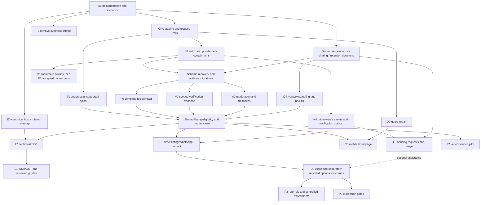

# HousePlug dependency map and pull-request implementation plan

Original discovery plan, updated for the founder’s direct student-to-agent WhatsApp requirement on 11 November 2026. Implementation is in draft PR #3; current coverage is in houseplug-release-runbook.md. Agent assignment and inspection management are not dependencies of property contact. Do not merge or deploy until this correction is reviewed.

## Dependency map

Existing Paystack hardening is a parallel P0 track after QA0/security and explicit financial-design review. Do not wait for a homepage refresh to investigate privacy or fulfilment issues. E0 and Q0 are small high-value parallel tracks once tests and configuration ownership are established.

## PR boundaries

Every PR: one concrete behavior, pinned base, targeted tests, affected routes and rollback described. Use a feature branch and preview/staging. Do not push to main or deploy production by default. Historical migrations stay unchanged; new repairs must consider effective schema, not assumed migration order.

| PR | Tickets and exact purpose | Main files / changes | Verification and rollback |
|---|---|---|---|
| A0 | Audit documentation only | docs/houseplug-current-state.md, docs/houseplug-backlog.md, docs/houseplug-implementation-plan.md | Link/path checks and factual evidence review; revert docs only |
| A1 | QA0 source/build/security baseline | package.json/lock only as needed; test config, tests, CI workflow; staging runbook | Focused tests, required npm build with staged env; no live mutation tests; revert harness/config |
| S1 | S0/R0 immediate private read and privileged write containment | new SQL repair(s), private/public projection helpers, affected public page reads, auth role allowlist | Guest/student/owner/other owner/admin role matrix, direct PostgREST attempts, public cards regression; migration rollback designed to preserve confidentiality, not restore unsafe grants |
| T0 | Remove synthetic public fallback | app/(main)/listing/[id]/page.tsx and targeted route tests | IDs 1/2/3 404; unknown UUID 404, real active UUID 200, owner/admin preview; no migration; revert only if still blocks demos publicly |
| T1 | Conservative sharing suppression | components/listing-card.tsx, components/listing/contact-card.tsx, components/listing/roommate-split-section.tsx, listing detail and share surfaces | All unsupported split text/actions absent at mobile/desktop; general roommate discovery retained; no migration; rollback must preserve safe suppression |
| T2 | Trust/count/cost wording containment | homepage/cards/contact/landlord-card/metadata/OG/JSON-LD and display helpers | Profile status never physical inspection; no hardcoded 500+ or unknown fee zero; wording approved; no destructive data changes |
| Q1 | Q0 repair functional filters | components/hero-search.tsx, components/filter-sidebar.tsx, app/(main)/browse/page.tsx, shared query helper | Type/rent budget/verified/amenities predicates and URL state; rent vs total explicit; integration + mobile smoke; revert query helper/callers together |
| E0 | Host policy and sitemap/robots | shared site URL helper, app/sitemap.ts, app/robots.ts, metadata/OG/schema callers, redirects only if approved | HTTP redirect chains, canonical host, sitemap XML locs, pagination and preview isolation; config rollback documented, no DNS changes |
| B0 | Recover reproducible schema | documented catalog diff, new baseline/repair plan, local schema fixtures | Clean reset and upgrade from copied sanitized schema; recover saved_listings/service base and missing columns; no production replay of legacy setup scripts |
| B1 | F0 additive fee domain/storage | types/index.ts, new fee helper, additive listing_fees or mapped existing model, write APIs/forms and admin review | Unit totals/unknown/refundable/currency units + RLS integration; nullable additive migration; old rent display remains readable; no guessing backfill |
| B2 | V0 evidence and authorized occupancy | evidence model + private storage pointers, admin verification UI/API, sharing permission/capacity form fields | Expiry/revoke/scope and occupancy 1/2/3 tests; no historic physical-inspection inference; reads fall back to conservative labels |
| B3 | A0 freshness/moderation and reporting | status mapping and server transitions, availability confirmation, stale job, report queue | Owner cannot approve self; active fee edit requires review; stale/rented hidden; concurrency/retry tests; dual-compatible reads and staged feature flag |
| B4 | I0 operator backfill and promoted eligibility | reviewed audit export/report, approved corrections import, shared eligibility helper | All promoted records meet fees/evidence/freshness gates; sampled reconciliation signed; dry-run then owner-authorized data change; per-row undo log |
| P1 | Existing payment ownership/order validation | app/api/payments/initiate/route.ts, verify/callback/webhook, lib/paystack.ts and billing input checks | Test provider, other-owner deny, expected amount/currency/product; no new fee architecture; owner review |
| P2 | Atomic payment fulfilment and retry | lib/billing.ts, fulfilment/outbox state migration, redacted logging | Concurrent/replayed callback once; simulated mid-write crash recovers; reconciliation dry-run; preserve payment audit; no blind revert of financial state |
| A2 | N0 event schema + safe flags + notification outbox | minimal server event utility/storage, explicit flags, redacted payloads, notification retry | Duplicate events and retry, no PII/consent leakage, flags off fail safely; support fixture and retention tests |
| C1 | L0 persisted housing assistance and admin triage | housing request schema/actions/API/UI, admin triage, reference IDs, consent | Idempotent saved request, denied cross-user access, spam/validation, successful commit before success UI; flag off preserves records |
| C2 | L1 direct WhatsApp contact, preserving existing functionality | Listing contact CTA, prefilled message helper, click tracking and regression tests | Guest contacts the responsible advertiser without login, a request, assignment, payment or booking; name/reference/URL included; click does not create an enquiry or outcome; optional assistance remains separate |
| C3 | C0 homepage redesign | app/page.tsx, hero/search/home components and relevant styles | Exact brief copy, eligible supply and empty campus assistance, 320/360/375/768/1280, keyboard, a11y; flag reverts layout but retains truth fixes |
| D1 | E1 SEO/performance/accessibility | metadata/schema, image/rendering and automated SEO checks | Rich Results semantic review, indexability/status/sitemap smoke, measured lab tests; real-user CWV remains separately measured |
| D2 | G0 UNIPORT/area hubs and guides | new hub/editorial routes reusing listing eligibility | Published original reviewed content and meaningful supply; noindex/hold empty hubs; redirects only to true successors |
| E1 | O0 ops tools / quality queues | existing landlord/admin dashboards extended | Own-agent access, duplicate/report/recheck workflow and complete audit; operator runbook |
| E2 | R1 roommate safety | existing roommate models/pages/actions extended | Accepted private connections, decline/revoke/block/report, expiry and visibility consent; policy review before sensitive rollout |
| E3 | SV0/SV1 services staged pilot | existing service components/model + request/vetting workflow | Commercial continuity, vetted category thresholds, safety and complaint operations; flag discovery without destroying paid records |
| F1 | D0 dashboards then GR0/EXP0 | existing admin analytics extended, referral/experiment helpers | Exact funnel denominators, no contact PII, qualified vs click distinction; no public outcome guarantee |
| F2 | GOV0 launch/restore review and P3 gates | release/runbook/monitoring documentation | CI/staging/manual mobile/privacy review, sampled data, restore rehearsal, operator readiness; no automatic expansion/escrow |

## Smallest safe first product PR

Recommend **T0: remove synthetic listing fallbacks**. It is source-confirmed, self-contained, requires no production schema or external credentials, and removes fabricated inventory immediately. Change only the fallback block and dead fallback support in `app/(main)/listing/[id]/page.tsx`, plus a focused route regression test. Keep the existing eligibility/notFound flow and real UUID owner/admin previews. Verify the public 404 cases and real active fixture. Run build in configured staging and capture mobile/desktop real-listing regression screenshots. No migration, fee change, legal text or deployment needed.

S0 is the higher-severity investigation and should begin alongside T0; if deployed access checks confirm exposed sensitive fields or privilege escalation, containment takes precedence over all product work. Do not use this audit as authorization to change production grants. T1 split suppression is the next narrow truth PR; full re-enablement waits for explicit permission data.

## Rollout/backfill mechanics

1. Recover catalog/migrations and backup/restore evidence in isolated staging; identify policy/trigger conflicts and preserve current route behavior.
2. Add nullable schema and typed compatibility reads; old annual rent/profile fields remain until audited replacements are complete.
3. Gate new forms and workflows with server-side flags; shadow-compute eligibility/costs without publishing speculative values.
4. Dry-run promoted listing reconciliation; owner reviews costs, evidence scope, sharing and confirmation dates.
5. Review staged diff, privacy/authz/mobile/test evidence and operator runbook. Production migrations and financial/legal/policy changes have separate owner sign-off.
6. Release by small cohort with redacted error/outcome metrics; stop new workflow intake on rollback while preserving existing requests/payment history.

Never use a rollback that restores public private-data access, deletes financial history, fabricates unknown fields or loses consented assistance requests. Prefer forward repairs for additive schema/financial state.

## Review boundary

The founder authorizes this product correction on the existing implementation branch. Keep PR #3 draft. Do not merge, deploy, apply production SQL, enable new charges or send messages. See houseplug-direct-contact-model.md for the current product contract and its acceptance tests.
